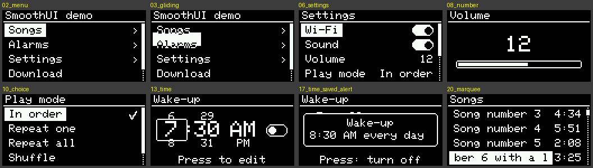
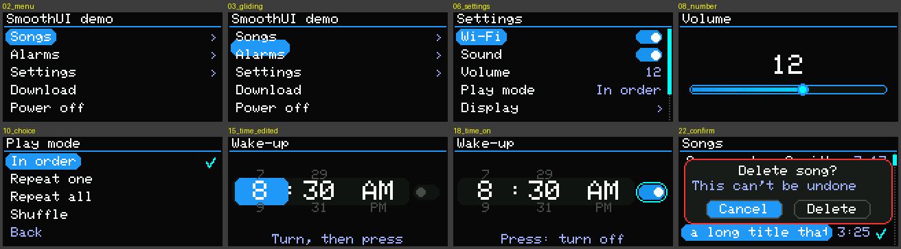

# SmoothUI

Smooth, animated menus for OLED and TFT displays on Arduino, by **Oshan Dissanayaka**.

One library for monochrome OLEDs and colour TFTs: pick your display by
uncommenting one line, then build menus, lists, switches, sliders, choice
lists, time pickers, timers, alerts, yes/no questions and progress screens in
a few lines. You drive it with a rotary encoder or push buttons.

- Rows **unfold** when a list opens.
- The selection bar **glides** to the new row and **stretches** to fit its text.
- Pages **slide** in and out.
- Long titles **scroll**, and switches **slide**.
- On OLEDs the selection is an inverted cursor; on TFTs it's a rounded accent bar with gradient sliders.

| 128x64 OLED | 160x80 TFT |
|---|---|
|  |  |

## Supported displays

| Define | Display |
|---|---|
| `SMOOTHUI_SSD1306_128X64` | 0.96" / 1.3" SSD1306 OLED (I2C), 128x64 |
| `SMOOTHUI_SSD1306_128X32` | 0.91" SSD1306 OLED (I2C), 128x32 |
| `SMOOTHUI_SH1106_128X64` | 1.3" SH1106 OLED (I2C), 128x64 |
| `SMOOTHUI_ST7735_160X80` | 0.96" IPS ST7735S TFT (SPI), 160x80 |
| `SMOOTHUI_ST7735_160X128` | 1.8" ST7735 TFT (SPI), 160x128 |
| `SMOOTHUI_ST7789_240X135` | 1.14" IPS ST7789 (TTGO T-Display), 240x135 |
| `SMOOTHUI_ST7789_240X240` | 1.3" / 1.54" IPS ST7789, 240x240 |
| `SMOOTHUI_ST7789_320X240` | 2.0" IPS ST7789, 320x240 |
| `SMOOTHUI_ILI9341_320X240` | 2.4" / 2.8" ILI9341, 320x240 |
| `SMOOTHUI_CUSTOM_DISPLAY` | Any Adafruit_GFX display you set up yourself |

**Boards:** ESP32 (all variants), RP2040 / Pico, STM32, SAMD, nRF52, Uno R4, and
others with about 32 KB of RAM or more. It doesn't fit an Arduino Uno / Nano
(ATmega328, 2 KB RAM).

## Installing

1. Arduino IDE: **Sketch → Include Library → Add .ZIP Library…** and choose `SmoothUI-1.0.0.zip`.
2. Install the Adafruit driver for your display from the Library Manager:
   - **Adafruit GFX Library** and **Adafruit BusIO** (always)
   - **Adafruit SSD1306**, **Adafruit SH110X**, **Adafruit ST7735 and ST7789 Library** or **Adafruit ILI9341**

## Choosing the display

Either uncomment one line in `src/SmoothUI_Config.h`:

```cpp
// #define SMOOTHUI_SSD1306_128X64
#define SMOOTHUI_ST7735_160X80        // <- this one
```

or define it in your sketch **before** the include (and the same for pins):

```cpp
#define SMOOTHUI_ST7789_240X240
#define SMOOTHUI_PIN_CS   5
#define SMOOTHUI_PIN_DC   16
#define SMOOTHUI_PIN_RST  17
#define SMOOTHUI_PIN_BL   4          // backlight, optional
#define SMOOTHUI_PIN_SCLK 18         // optional: default SPI pins otherwise
#define SMOOTHUI_PIN_MOSI 23
#include <SmoothUI.h>
```

OLEDs use the board's I2C pins (set `SMOOTHUI_PIN_SDA` / `SMOOTHUI_PIN_SCL` on
ESP32 / RP2040 for other pins; `SMOOTHUI_I2C_ADDRESS` defaults to 0x3C).
If a TFT shows inverted colours or a shifted picture, see the options in
section 3 of `SmoothUI_Config.h` (`SMOOTHUI_INVERT_COLORS`,
`SMOOTHUI_ROTATION`, `SMOOTHUI_ST7735_TAB`).

## Quick start

```cpp
#define SMOOTHUI_SSD1306_128X64
#include <SmoothUI.h>

SmoothUI ui;
SmoothEncoder knob(32, 33, 25);       // A, B, push button (to GND)
SmoothMenu mainMenu("Main menu");
SmoothMenu settings("Settings");

bool ledOn = false;
int volume = 10;

void hello() { ui.alert("Hello!", "SmoothUI is running"); }

void setup() {
  settings.addToggle("LED", &ledOn);
  settings.addNumber("Volume", &volume, 0, 21);

  mainMenu.addAction("Say hello", hello);
  mainMenu.addMenu("Settings", &settings);

  knob.begin();
  ui.begin(&mainMenu, &knob);
}

void loop() {
  ui.update();          // reads the knob, animates, draws
}
```

**Controls:** turn = move, press = choose, hold = back. Every list ends with a
"Back" row (set `SMOOTHUI_BACK_ROW 0` to hide it).

## Widgets

### Menu items (`SmoothMenu`)

Values live in your own variables; the menu edits them directly.

```cpp
menu.addAction("Restart", restartFn);                    // runs a function
menu.addMenu("Settings", &settingsMenu);                  // opens any page
menu.addToggle("Wi-Fi", &wifiOn, onWifi);                 // on/off switch
menu.addNumber("Volume", &vol, 0, 21, 1, "", onVol);      // slider page
menu.addChoice("Mode", modes, 4, &mode, onMode);          // pick one, tick shows the choice
menu.addTime("Wake-up", &wakeMin, &wakeOn, onWake);       // wheel picker with on/off switch
menu.addTime("Reminder", &remindMin);                     // wheel picker with Save
menu.addInfo("Version", "1.0.0");                         // read-only text
menu.addInfo("Uptime", uptimeFn);                         // text from a function, refreshed
```

All callbacks are optional. `onX` runs when the value changes:
`void onWifi(bool on)`, `void onVol(int v)`, `void onMode(int index)`,
`void onWake(int minutes, bool enabled)`. Times are minutes after midnight,
e.g. `7 * 60 + 30` for 7:30.

**Time picker:** turn to choose the hour, minute and AM/PM, then press to
edit (the wheel turns blue) and press again when done. With an `enabled`
variable it works like an alarm: changing the time switches it off, and
switching it on saves the time and confirms it with a popup. Set
`SMOOTHUI_24H 1` for 24-hour wheels.

### Long lists (`SmoothList`)

A list filled by your functions, for files, songs or Wi-Fi networks. It stores
nothing per entry, so it can have hundreds.

```cpp
int count() { return fileCount; }
const char* name(int i, char* buf, size_t n) { return files[i]; }
void open(int i) { play(i); }
void hold(int i) { ui.confirm("Delete?", files[i], onDeleteAnswer, "Delete", "Cancel", true); }

SmoothList files("Files", count, name, open, hold);   // hold is optional
files.setRightText(sizeFn);     // optional text on the right ("3:25", "2 MB")
files.setChecked(isPlayingFn);  // optional tick
```

### Popups

```cpp
ui.alert("Saved", "Settings stored", 2000);                 // closes after 2 s or a press
ui.confirm("Power off?", "Hold the knob to turn on",        // two buttons, safe one first
           onAnswer, "Power off", "Cancel", true);          // true = red "danger" button
void onAnswer(bool yes) { if (yes) powerOff(); }
```

### Progress screen

```cpp
SmoothProgressPage job("Downloading");
ui.show(&job);
job.set(0.42f, "episode-42.mp3");   // 0..1
job.set(-1, "Connecting...");       // < 0 shows a spinner
job.onCancel(cancelFn);             // optional: long press cancels
ui.back();                          // close it
```

### Timers (`SmoothCountdown`)

```cpp
SmoothCountdown sleepTimer;
ui.add(&sleepTimer);                         // checked by ui.update()
sleepTimer.startMinutes(30, goToSleep);      // goToSleep() runs at zero
sleepTimer.remainingMinutes();  sleepTimer.format(buf, sizeof(buf));  // "29:59"
sleepTimer.stop();
```

See `examples/SleepTimer` for a sleep timer chosen from a list, with the time left shown in the menu.

### Input

```cpp
SmoothEncoder knob(pinA, pinB, pinButton);           // interrupt-driven, no missed steps
SmoothEncoder knob(pinA, pinB, pinButton, 2, true);  // 2 steps per click, reversed
SmoothButtons keys(pinUp, pinDown, pinOk, pinBack);  // Back optional (hold OK = back)
ui.handle(SmoothEvent::Next);                        // or feed events yourself
```

## Theme

```cpp
ui.theme.accent    = SmoothColor::rgb(255, 120, 0);   // selection, bars, switches
ui.theme.highlight = SmoothColor::rgb(255, 200, 80);  // ticks, scrollbar, focus
ui.theme.listSpeed = 88;    // rows unfolding      (0..99, higher = faster)
ui.theme.selectSpeed = 91;  // selection gliding
ui.theme.slideSpeed = 95;   // pages sliding
ui.theme.barSpeed = 95;     // bars, switches, scrollbar
ui.theme.font = &FreeSans9pt7b;   // any Adafruit GFX font (#include <Fonts/...>)
ui.theme.rowHeight = 20;          // 0 = automatic
```

Set the theme before `ui.begin()`, or call `ui.refreshLayout()` afterwards. On
mono OLEDs the colours are ignored. Colour screens of 120 px or taller can use
`#define SMOOTHUI_FONT &FreeSans9pt7b` (include the font first) for nicer text.

## Your own pages

Derive from `SmoothPage` and implement `tick()` (advance animations, return
true while moving), `draw(ui, ox)` (draw at x offset `ox`, using `ui.gfx()`
and helpers like `ui.text()`, `ui.bar()`, `ui.toggleSwitch()`) and `event()`.
Then open it with `ui.show(&page)`.

## Memory

- **OLEDs** draw into the driver's own frame buffer.
- **Colour TFTs** draw through a RAM strip of `SMOOTHUI_BUFFER_BYTES` (32 KB on ESP32 / RP2040), sent in bands, so a 320x240 screen animates without flicker or a full frame buffer.
- Each `SmoothMenu` holds `SMOOTHUI_MAX_ITEMS` items (20 by default).

## Licence

MIT. Copyright (c) 2026 Oshan Dissanayaka; see `LICENSE`.
The animation style was inspired by [Astra UI](https://github.com/AstraThreshold/oled-ui-astra); no code from it is used.
